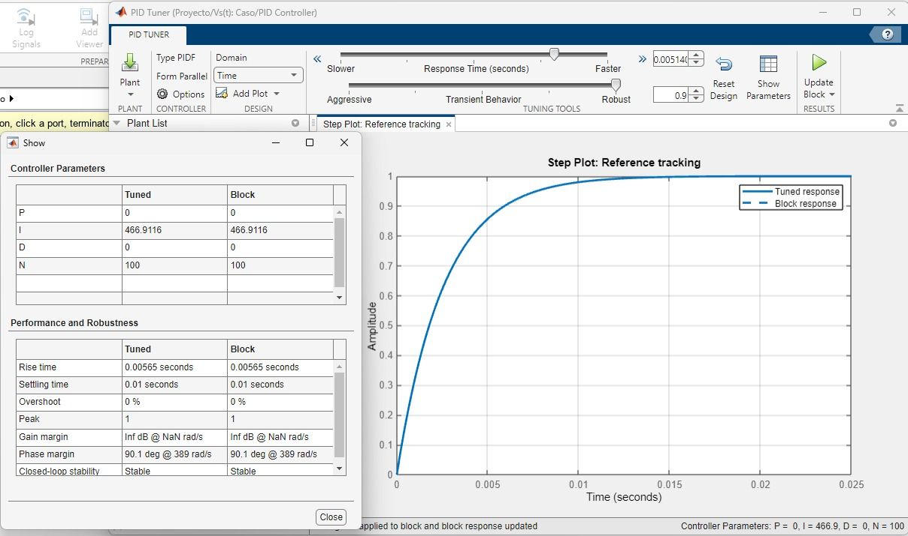
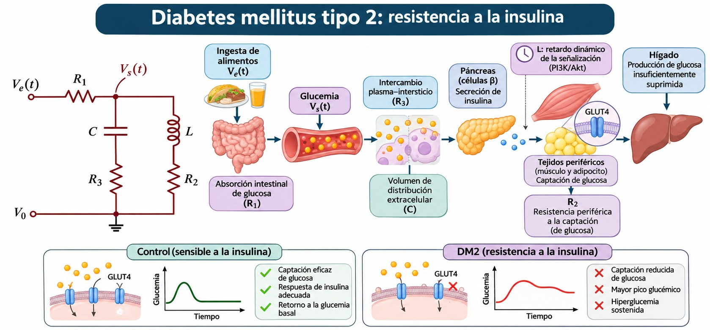
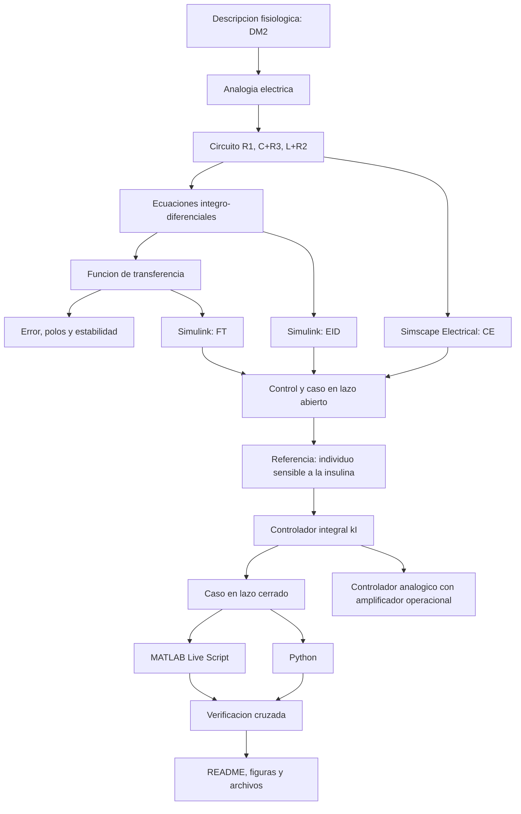

[](https://matlab.mathworks.com/open/github/v1?repo=USUARIO/REPOSITORIO)

# Proyecto — Modelado y control del sistema endócrino: diabetes mellitus tipo 2 (resistencia a la insulina)

Repositorio académico de la asignatura **Modelado de Sistemas Fisiológicos**, correspondiente al programa de **Ingeniería Biomédica** del Tecnológico Nacional de México / Instituto Tecnológico de Tijuana. El proyecto integra interpretación fisiológica, analogía eléctrica, formulación matemática, análisis temporal y de estabilidad, control clásico, simulación computacional (MATLAB, Simulink, Simscape Electrical y Python) y diseño de un controlador analógico.

El caso de estudio representa de forma simplificada la **regulación de la glucemia** mediante un circuito eléctrico de **segundo orden** formado por $R_1$, $R_3$, $C$, $L$ y $R_2$. Se compara una condición de referencia (**control**, individuo sensible a la insulina) con una condición alterada (**caso**, diabetes mellitus tipo 2 con resistencia a la insulina), y se diseña un controlador **integral (PID con $k_P=0$, $k_D=0$)** que lleva la respuesta del caso hacia la del control.

**Docente:** Dr. Paul Antonio Valle Trujillo  
**Correo:** paul.valle@tectijuana.edu.mx  
**Departamento:** Ingeniería Eléctrica y Electrónica  
**Institución:** Tecnológico Nacional de México / Instituto Tecnológico de Tijuana  
**Asignatura:** Modelado de Sistemas Fisiológicos  
**Programa:** Ingeniería Biomédica  
**Equipo:**

| Integrante | Número de control |
|---|---|
| Ortega Odabachea Gustavo | 23212223 |
| Suarez Ceja Vanessa Yamileth | 23212236 |
| Trejo Paz Gabriel Fernando | 23212239 |

**Correo institucional (Gustavo Ortega):** L23212223@tectijuana.edu.mx  
**Sede:** Blvd. Alberto Limón Padilla s/n, Tijuana, C. P. 22454, B. C., México.

---

<a id="contenido"></a>
## Contenido

1. [Resumen](#resumen)
2. [Competencia y objetivos](#objetivos)
3. [Relación con el temario](#temario)
4. [Sistema fisiológico y enfermedad seleccionada](#sistema)
5. [Interpretación fisiológica y analogía eléctrica](#analogia)
6. [Formulación matemática](#modelo)
7. [Análisis de error, estabilidad y bosquejo de la respuesta](#analisis)
8. [Entrada y condiciones de simulación](#senales)
9. [Implementación en MATLAB, Simulink y Simscape](#matlab)
10. [Control en lazo cerrado y sintonización del controlador](#pid)
11. [Diseño del controlador analógico](#analogico)
12. [Interpretación fisiológica del sistema de control](#interpretacion)
13. [Reproducción en Python](#python)
14. [Diagrama biológico](#biologico)
15. [Resultados computacionales y verificación cruzada](#resultados)
16. [Discusión](#discusion)
17. [Conclusiones](#conclusiones)
18. [Flujo de trabajo y actividades](#flujo)
19. [Estructura del repositorio](#estructura)
20. [Requisitos y reproducibilidad](#requisitos)
21. [Declaración del uso de LLM](#llm)
22. [Referencias](#referencias)

---

<a id="resumen"></a>
## Resumen

El proyecto desarrolla un procedimiento de **modelado, análisis, simulación y control** de la regulación de la glucemia en la diabetes mellitus tipo 2 (DM2). La ingesta de alimentos $V_e(t)$ se transmite a través de una resistencia $R_1$ (absorción intestinal de glucosa) hacia un nodo donde convergen dos ramas en paralelo: una rama $C$–$R_3$ (volumen de distribución extracelular e intercambio plasma–intersticio) y una rama $L$–$R_2$ (retardo dinámico de la señalización de la insulina, vía PI3K/Akt, y resistencia periférica a la captación de glucosa). La salida $V_s(t)$ representa la **glucemia** normalizada.

Se estudian dos configuraciones. En el **control** ($R_2=R_3=1\,\mathrm{k}\Omega$, $L=100\,\mathrm{mH}$, $C=100\,\mu\mathrm{F}$) y en el **caso** ($R_2=R_3=10\,\mathrm{k}\Omega$, $L=500\,\mathrm{mH}$, $C=100\,\mu\mathrm{F}$). A partir de las leyes de Kirchhoff y la transformada de Laplace se obtiene una función de transferencia de segundo orden. Ambos sistemas resultan estables y sobreamortiguados, pero el caso se estabiliza en $0.9091\,\mathrm{V}$, frente a $0.5\,\mathrm{V}$ del control, y su polo dominante es más lento. Esto reproduce de forma cualitativa la **hiperglucemia sostenida** de la resistencia a la insulina.

La respuesta del control se usa como referencia para el caso en un lazo de retroalimentación negativa. La herramienta *PID Tuner* de Simulink entregó un controlador **integral** con $k_I=466.9116$ ($k_P=0$, $k_D=0$), que también se reproduce en Python con `python-control`. A partir de ese valor se calculan los componentes de su realización analógica con un amplificador operacional integrador ($C_r=1\,\mu\mathrm{F}$, $R_e=2141.73\,\Omega$).

**Palabras clave:** sistema endócrino; diabetes mellitus tipo 2; resistencia a la insulina; glucemia; analogía eléctrica; circuito RLC de segundo orden; función de transferencia; controlador integral; MATLAB; Simulink; Simscape Electrical; Python.

[Volver al contenido](#contenido)

---

<a id="objetivos"></a>
## Competencia y objetivos

### Competencia a desarrollar

Modelizar sistemas fisiológicos mediante analogías eléctricas, ecuaciones diferenciales y funciones de transferencia para analizar su comportamiento dinámico, y diseñar estrategias de control mediante técnicas de control clásico, contrastando los resultados mediante modelado analítico y simulación computacional.

### Objetivo general

Modelar la regulación de la glucemia en un individuo sensible a la insulina (control) y en uno con resistencia a la insulina (DM2) mediante un circuito eléctrico equivalente, comparar sus respuestas y diseñar un controlador que reduzca la diferencia dinámica entre ambas.

### Objetivos específicos

- Interpretar la ingesta, absorción, distribución, secreción de insulina y captación periférica de glucosa, y asociarlas con $V_e$, $F_e$, $R_1$, $R_3$, $C$, $L$, $R_2$, $F_s$ y $V_s$.
- Construir el circuito equivalente del control y del caso.
- Obtener $G(s)=V_s(s)/V_e(s)$ y las funciones $G_{control}(s)$ y $G_{caso}(s)$.
- Calcular el error en estado estacionario y los polos, y determinar la estabilidad.
- Implementar ecuaciones integro-diferenciales, función de transferencia y circuito equivalente en Simulink/Simscape.
- Sintonizar un controlador y analizar su efecto en lazo cerrado.
- Reproducir el análisis en MATLAB (cuaderno) y Python.
- Calcular los componentes del controlador analógico.
- Documentar de forma reproducible archivos, resultados y limitaciones.

[Volver al contenido](#contenido)

---

<a id="temario"></a>
## Relación con el temario

| Unidad | Área | Contenidos aplicados |
|---|---|---|
| I | Sistemas de control retroalimentados | Diagrama de bloques, señal de error, respuesta temporal, estabilidad y retroalimentación negativa |
| II | Modelado matemático | Analogía eléctrica, ecuaciones integro-diferenciales, Laplace y función de transferencia |
| III | Controladores | Acción integral, sintonización de ganancias y realización analógica con amplificador operacional |

El enfoque combina **Ingeniería de Control, Electrónica Analógica, Ciencias de la Computación y Fisiología**.

[Volver al contenido](#contenido)

---

<a id="sistema"></a>
## Sistema fisiológico y enfermedad seleccionada

### Sistema fisiológico: regulación endócrina de la glucosa

Tras una comida, la glucosa se absorbe en el intestino y pasa a la sangre. Desde el plasma se distribuye al espacio extracelular y al intersticio. El aumento de glucemia estimula a las células β del páncreas para secretar insulina. La insulina actúa sobre los tejidos periféricos (músculo y adipocito), donde favorece la translocación del transportador **GLUT4** a la membrana y con ello la captación de glucosa. También reduce la producción hepática de glucosa. El conjunto devuelve la glucemia a su nivel basal.

### Enfermedad: diabetes mellitus tipo 2 (resistencia a la insulina)

En la DM2 los tejidos periféricos responden de forma deficiente a la insulina (**resistencia a la insulina**). La señalización posterior al receptor (vía PI3K/Akt) se retrasa o se debilita, la translocación de GLUT4 es menor, la captación periférica de glucosa disminuye y el hígado no suprime lo suficiente su producción de glucosa. Como consecuencia, tras una carga de glucosa la glucemia alcanza un pico mayor y permanece elevada (**hiperglucemia sostenida**). En el modelo, esto se traduce en el aumento de la resistencia periférica a la captación ($R_2$), del intercambio plasma–intersticio ($R_3$) y del retardo de la señalización ($L$).

[Volver al contenido](#contenido)

---

<a id="analogia"></a>
## Interpretación fisiológica y analogía eléctrica

En la DM2, los tejidos periféricos (músculo y adipocito) responden de forma deficiente a la insulina: el transportador GLUT4 se transloca menos a la membrana, la captación de glucosa disminuye, el hígado no suprime lo suficiente su producción de glucosa y la glucemia permanece elevada. El modelo es **fenomenológico y académico**: reproduce cualitativamente absorción, distribución, retardo y resistencia a la captación, pero no equivale a magnitudes fisiológicas medidas.

| Variable o proceso fisiológico | Representación | Interpretación en el modelo |
|---|---|---|
| Ingesta de alimentos | $V_e(t)$ | Estímulo de entrada (carga de glucosa) |
| Flujo de glucosa hacia el compartimento | $F_e(t)$ | Corriente que sale de la fuente |
| Absorción intestinal de glucosa | $R_1$ | Oposición durante el paso de glucosa al plasma |
| Volumen de distribución extracelular | $C$ | Almacenamiento temporal de glucosa |
| Intercambio plasma–intersticio | $R_3$ | Resistencia en serie con $C$ |
| Retardo dinámico de la señalización (PI3K/Akt) | $L$ | Inercia: resistencia a cambios rápidos en la respuesta del tejido |
| Resistencia periférica a la captación de glucosa | $R_2$ | Oposición a la utilización de glucosa por músculo y adipocito |
| Flujo asociado con la captación periférica | $F_s(t)$ | Corriente de la rama $L$–$R_2$ |
| Glucemia | $V_s(t)$ | Salida normalizada en el nodo de unión de $R_1$, $C$ y $L$ |

La tabla anterior es la **tabla de correspondencias fisiológicas** del proyecto.

### Circuito eléctrico equivalente

El circuito se muestra en el diagrama biológico ([`Diagrama_Biorender.jpeg`](./Diagrama_Biorender.jpeg)) y como esquema manuscrito en [`Analisis_matematico.pdf`](./Analisis_matematico.pdf).

### Topología del circuito

- Rama principal: fuente $V_e(t)$ en serie con $R_1$.
- Nodo posterior a $R_1$ (donde se mide $V_s$): dos ramas en paralelo hacia la referencia, $C$ en serie con $R_3$ y $L$ en serie con $R_2$.
- $F_e(t)=F_c(t)+F_s(t)$, donde $F_c$ es la corriente de la rama $C$–$R_3$ y $F_s$ la de la rama $L$–$R_2$.
- Dos elementos independientes de almacenamiento de energía ($C$ y $L$) implican un sistema de **segundo orden**.

El esquema manuscrito del circuito, con $V_e$, $V_s$, $F_e$, $F_s$, $F_c$, nodos y referencia, se encuentra en la primera página de [`Analisis_matematico.pdf`](./Analisis_matematico.pdf).

### Parámetros del control y del caso

| Componente | Control (sensible a la insulina) | Caso (DM2) |
|---|---:|---:|
| $R_1$ | $1\,\mathrm{k}\Omega$ | $1\,\mathrm{k}\Omega$ |
| $R_2$ | $1\,\mathrm{k}\Omega$ | $10\,\mathrm{k}\Omega$ |
| $R_3$ | $1\,\mathrm{k}\Omega$ | $10\,\mathrm{k}\Omega$ |
| $L$ | $100\,\mathrm{mH}$ | $500\,\mathrm{mH}$ |
| $C$ | $100\,\mu\mathrm{F}$ | $100\,\mu\mathrm{F}$ |

En el caso aumentan $R_2$ (resistencia periférica a la captación), $R_3$ (intercambio plasma–intersticio) y $L$ (retardo de la señalización), mientras que $R_1$ y $C$ se conservan.

> **Nota de consistencia.** La página 4 del análisis manuscrito enlista el caso con $L=100\,\mathrm{mH}$ y $C=500\,\mu\mathrm{F}$. Sin embargo, los coeficientes que ahí se usan ($0.55s^2+12{,}000.5s+11{,}000$), los de la función de transferencia en Simulink y Python, y las ganancias de los bloques EID del modelo (`L = 500e-3`, `1/C = 1/100e-6`) corresponden a $L=500\,\mathrm{mH}$ y $C=100\,\mu\mathrm{F}$. Este README adopta estos últimos valores. Se recomienda corregir la lista de parámetros en el manuscrito.

[Volver al contenido](#contenido)

---

<a id="modelo"></a>
## Formulación matemática

### 1. Ecuaciones principales

Aplicando las leyes de Kirchhoff:

$$
V_e(t)=R_1F_e(t)+V_s(t),
$$

$$
V_s(t)=\frac{1}{C}\int\left[F_e(t)-F_s(t)\right]dt+R_3\left[F_e(t)-F_s(t)\right],
$$

$$
V_s(t)=L\frac{dF_s(t)}{dt}+R_2F_s(t),
$$

con $F_c(t)=F_e(t)-F_s(t)$.

### 2. Transformada de Laplace y procedimiento algebraico

Con condiciones iniciales nulas:

$$
V_e(s)=R_1F_e(s)+V_s(s),\qquad
V_s(s)=\frac{R_3Cs+1}{Cs}\left[F_e(s)-F_s(s)\right],\qquad
V_s(s)=(Ls+R_2)F_s(s).
$$

Igualando las dos últimas expresiones y despejando $F_e(s)$:

$$
F_e(s)=\frac{CLs^2+C(R_2+R_3)s+1}{R_3Cs+1}\,F_s(s).
$$

Al sustituir en la primera ecuación:

$$
V_e(s)=\frac{LC(R_1+R_3)s^2+\left[L+C(R_1R_2+R_1R_3+R_2R_3)\right]s+(R_1+R_2)}{R_3Cs+1}\,F_s(s).
$$

### 3. Función de transferencia

Dividiendo $V_s(s)=(Ls+R_2)F_s(s)$ entre la expresión anterior:

$$
\boxed{
G(s)=\frac{V_s(s)}{V_e(s)}
=\frac{R_3LC\,s^2+(L+R_2R_3C)\,s+R_2}{LC(R_1+R_3)\,s^2+\left[L+C(R_1R_2+R_1R_3+R_2R_3)\right]s+(R_1+R_2)}
}
$$

El orden dos se relaciona directamente con los dos elementos de almacenamiento, $C$ y $L$.

### 4. Modelos numéricos

Para el **control**:

$$
\boxed{G_{control}(s)=\frac{0.01\,s^{2}+100.1\,s+1000}{0.02\,s^{2}+300.1\,s+2000}}
$$

Para el **caso**:

$$
\boxed{G_{caso}(s)=\frac{0.5\,s^{2}+10000.5\,s+10000}{0.55\,s^{2}+12000.5\,s+11000}}
$$

### 5. Modelo de ecuaciones integro-diferenciales

Para la implementación en Simulink (bloques de ganancia, integrador y derivador):

$$
F_e(t)=\frac{1}{R_1}\left[V_e(t)-V_s(t)\right],
$$

$$
V_s(t)=\frac{1}{C}\int\left[F_e(\tau)-F_s(\tau)\right]d\tau+R_3\left[F_e(t)-F_s(t)\right],
$$

$$
F_s(t)=\frac{1}{R_2}\left[V_s(t)-L\frac{dF_s(t)}{dt}\right].
$$

Los desarrollos manuscritos se conservan en [`Analisis_matematico.pdf`](./Analisis_matematico.pdf). Los coeficientes coinciden con los bloques de función de transferencia de `Proyecto.slx` y con `Ortega23212223.py`.

[Volver al contenido](#contenido)

---

<a id="analisis"></a>
## Análisis de error, estabilidad y bosquejo de la respuesta

### 1. Respuesta final y error en estado estacionario

Para $V_e(s)=1/s$, el valor final es $G(0)=R_2/(R_1+R_2)$ y el error respecto de la entrada unitaria es

$$
e_{ss}=\lim_{s\to0}s\cdot\frac1s\left[1-G(s)\right]=1-\frac{R_2}{R_1+R_2}.
$$

| Condición | $G(0)$ | Respuesta final | $e_{ss}$ |
|---|---:|---:|---:|
| Control | $0.5$ | $0.5\,\mathrm{V}$ | $0.5\,\mathrm{V}$ |
| Caso (DM2) | $0.9091$ | $0.9091\,\mathrm{V}$ | $0.0909\,\mathrm{V}$ ($90.91\,\mathrm{mV}$) |

En régimen permanente $L$ se comporta como cortocircuito y $C$ como circuito abierto, de modo que $V_s$ queda determinado por el divisor resistivo $R_2/(R_1+R_2)$. Al aumentar $R_2$ (resistencia a la captación), la glucemia final es mayor: $0.9091\,\mathrm{V}$ frente a $0.5\,\mathrm{V}$, es decir, una diferencia de $0.4091\,\mathrm{V}$ ($\approx 82\,\%$ más que el control). El error respecto de la entrada es menor en el caso, pero eso solo indica que la salida se acerca más a la entrada, es decir, que la glucemia permanece alta.

### 2. Polos, ceros y estabilidad

Raíces del polinomio característico:

| Condición | $p_1\ (\mathrm{s^{-1}})$ | $p_2\ (\mathrm{s^{-1}})$ | Tipo de respuesta |
|---|---:|---:|---|
| Control | $-6.6674$ | $-14\,998.3326$ | Estable, sobreamortiguada |
| Caso | $-0.9167$ | $-21\,818.1742$ | Estable, sobreamortiguada |

Los ceros son $-10$ y $-10\,000$ para el control, y $-1$ y $-20\,000$ para el caso. Todos los polos son reales y negativos (semiplano izquierdo). Las constantes de tiempo dominantes son $\tau\approx1/6.6674\approx0.15\,\mathrm{s}$ para el control y $\tau\approx1/0.9167\approx1.09\,\mathrm{s}$ para el caso, por lo que el caso evoluciona unas 7 veces más lento. En ambos sistemas el cero lento queda cerca del polo dominante, de modo que esa componente tiene amplitud pequeña y la respuesta se caracteriza por un salto inicial seguido de un ajuste lento.

### 3. Bosquejo cualitativo

- **Control:** salto inicial seguido de un ascenso exponencial hasta $0.5\,\mathrm{V}$, sin oscilaciones. En la simulación pasa de $\approx0.35\,\mathrm{V}$ justo después del escalón a $0.5\,\mathrm{V}$, y entra en la banda de $\pm2\,\%$ en $\approx0.4\,\mathrm{s}$.
- **Caso:** salto inicial a $\approx0.84\,\mathrm{V}$ y ascenso lento hasta $0.9091\,\mathrm{V}$, sin oscilaciones. Entra en la banda de $\pm2\,\%$ en $\approx1.6\,\mathrm{s}$ después del escalón. La glucemia sube más y permanece elevada.

Estas predicciones se confirman en las simulaciones de la sección [Resultados](#resultados).

[Volver al contenido](#contenido)

---

<a id="senales"></a>
## Entrada y condiciones de simulación

Se aplica un **escalón unitario** $V_e(t)=u(t-1)$ durante $t\in[0,10]\,\mathrm{s}$, con el escalón en $t=1\,\mathrm{s}$ para observar el estado previo y el transitorio.

| Parámetro | Valor |
|---|---:|
| Tiempo inicial | $0\,\mathrm{s}$ |
| Tiempo final | $10\,\mathrm{s}$ |
| Paso máximo / de muestreo | $10^{-3}\,\mathrm{s}$ |
| Instante del escalón | $1\,\mathrm{s}$ |
| Solucionador de Simulink | `ode15s` |
| Condiciones iniciales | Nulas |

**Justificación de la señal.** Se eligió el escalón unitario porque permite evidenciar con claridad la ganancia estacionaria, la constante de tiempo dominante y el tiempo de establecimiento, y con ello la diferencia entre control y caso. Representa un aporte sostenido de glucosa (tipo infusión continua), no una ingesta puntual, y no permite observar la recuperación hacia el nivel basal. Para representar una carga glucémica aguda sería más apropiado un pulso rectangular de duración finita, $V_e(t)=A\left[u(t-t_0)-u(t-(t_0+\Delta t))\right]$, que queda como mejora posible del modelo.

**Escala temporal.** La simulación usa segundos del circuito equivalente. No se establece una equivalencia con el tiempo fisiológico (por ejemplo, 1 s de simulación → 1 h fisiológica); los tiempos reportados son tiempos del modelo y no deben interpretarse como tiempos reales de absorción de glucosa o de acción de la insulina.

En Python la entrada se construye con

```python
t = np.linspace(t0, tend, N)
u = np.zeros(N)
u[round(1 / dt):] = 1
```

[Volver al contenido](#contenido)

---

<a id="matlab"></a>
## Implementación en MATLAB, Simulink y Simscape

El modelo [`Proyecto.slx`](./Proyecto.slx) contiene los subsistemas **Control** (`Vs(t): Control`) y **Caso** (`Vs(t): Caso`). En cada uno se construyen las tres representaciones y se comparan entre sí:

| Representación | Bloques | Salida |
|---|---|---|
| Ecuaciones integro-diferenciales (EID) | Ganancias $1/R_1$, $1/R_2$, $1/C$, $L$, $R_3$, integrador, derivador y sumadores | `Vs(t): Control EID` / `Vs(t): Caso EID` |
| Función de transferencia (FT) | Bloque *Transfer Fcn* con los coeficientes de $G(s)$ | `Vs(t): Control FT` / `Vs(t): Caso FT` |
| Circuito equivalente (CE) | Simscape Electrical: fuente controlada, $R_1$, $R_3$, $C$, $L$, $R_2$, referencia eléctrica y sensor | `Vs(t): Control CE` / `Vs(t): Caso CE` |

El subsistema **Caso** incorpora además el bloque *PID Controller* en retroalimentación negativa (salida `PID: Tratamiento`). A nivel superior se encuentran el bloque *Step*, los *Scopes* y los bloques *To Workspace* para las señales de entrada, control, caso y tratamiento.

### Cuaderno de MATLAB

[`Ortega23212223.mlx`](./Ortega23212223.mlx) abre el modelo, configura la simulación, recupera las señales y las grafica con la función `plotsignals`, que exporta la figura en PDF vectorial. Su exportación está en [`Ortega23212223.pdf`](./Ortega23212223.pdf).

```matlab
open_system('Proyecto')
parameters.StopTime = '10';
parameters.Solver   = 'ode15s';
parameters.MaxStep  = '1e-3';
X = sim('Proyecto', parameters);
plotsignals(X.t, X.Ve, X.Vex, X.Vey, X.PID, 'Respuesta')
```

[Volver al contenido](#contenido)

---

<a id="pid"></a>
## Control en lazo cerrado y sintonización del controlador

### 1. Esquema de control

La respuesta del control se utiliza como referencia para el caso, y el controlador actúa sobre la señal de error:

$$
e(t)=V_{s,control}(t)-V_{s,caso}(t).
$$

La planta controlada es $G_{caso}(s)$, y el lazo cerrado es

$$
T(s)=\frac{C_{PID}(s)\,G_{caso}(s)}{1+C_{PID}(s)\,G_{caso}(s)}.
$$

### 2. Ganancias obtenidas con *PID Tuner*

Forma paralela, dominio del tiempo, con *Response Time* $=0.00514\,\mathrm{s}$ y *Transient Behavior* $=0.9$. El resultado es un controlador **puramente integral**:

| Parámetro | Valor |
|---|---:|
| $k_P$ | $0$ |
| $k_I$ | $466.9116$ |
| $k_D$ | $0$ |
| $N$ (coef. del filtro derivativo) | $100$ (sin efecto, pues $k_D=0$) |

Por tanto, $C_{PID}(s)=k_I/s$.

### 3. Indicadores reportados

| Indicador | Resultado |
|---|---:|
| Tiempo de subida | $0.00565\,\mathrm{s}$ |
| Tiempo de establecimiento | $0.01\,\mathrm{s}$ |
| Sobreimpulso | $0\,\%$ |
| Valor pico | $1$ |
| Margen de ganancia | Infinito |
| Margen de fase | $90.1^\circ$ a $389\,\mathrm{rad/s}$ |
| Estabilidad en lazo cerrado | Estable |



El integrador introduce un polo en el origen en el lazo directo, por lo que el error en estado estacionario ante un escalón es cero aunque la planta del caso tenga ganancia DC finita de $0.9091$. Los indicadores de la tabla corresponden al seguimiento de un escalón unitario en el *PID Tuner*.

[Volver al contenido](#contenido)

---

<a id="analogico"></a>
## Diseño del controlador analógico

Un controlador integral se realiza con un amplificador operacional integrador, con impedancia de entrada $Z_i=R_e$ e impedancia de realimentación $Z_f=1/(C_rs)$. Su función de transferencia (magnitud, sin considerar la inversión de signo) es

$$
C_{PID}(s)=\frac{1}{R_eC_r\,s}=\frac{k_I}{s}.
$$

Fijando $C_r=1\,\mu\mathrm{F}$:

$$
R_e=\frac{1}{C_rk_I}=\frac{1}{(10^{-6})(466.9116)}.
$$

| Componente | Valor calculado |
|---|---:|
| $C_r$ (propuesto) | $1\,\mu\mathrm{F}$ |
| $R_e$ | $2141.7330\,\Omega$ |

Con estos valores, $C_{PID}(s)=1/(0.002142\,s)$, idéntico al usado en `Ortega23212223.py`.

[Volver al contenido](#contenido)

---

<a id="interpretacion"></a>
## Interpretación fisiológica del sistema de control

Esta correspondencia es **exclusivamente una analogía académica**. Las ganancias del controlador, las amplitudes de las señales y las variables calculadas no representan dosis, concentraciones farmacológicas ni recomendaciones terapéuticas.

1. **Variable fisiológica que se pretende modificar.** La glucemia $V_s(t)$ del caso, que se busca llevar al nivel del individuo sensible a la insulina (el control).
2. **Posible intervención real asociada.** Un tratamiento que aumente la captación de glucosa o reduzca su producción, como la administración de insulina o de un fármaco que mejore la sensibilidad a ella.
3. **Mecanismo general.** La señal de control corrige el sistema según la diferencia acumulada entre la glucemia del caso y la de referencia (acción integral). Una intervención real actuaría, por ejemplo, favoreciendo la translocación de GLUT4 y la captación periférica de glucosa, o disminuyendo la producción hepática.
4. **Diferencias entre el controlador matemático y una intervención real.** El controlador es lineal, ideal e instantáneo, y su señal puede tomar cualquier valor. Un tratamiento real tiene farmacocinética y farmacodinamia, retardos de absorción y de acción, variabilidad entre pacientes, límites de dosis y riesgo de efectos adversos como la hipoglucemia.
5. **Simplificaciones y limitaciones.** Modelo lineal, concentrado y de parámetros constantes; parámetros no medidos; entrada escalón sostenida; sin retroalimentación glucosa–insulina del páncreas ni producción hepática explícita; y referencia tomada de un modelo de individuo sano y no de datos clínicos.

[Volver al contenido](#contenido)

---

<a id="python"></a>
## Reproducción en Python

[`Ortega23212223.py`](./Ortega23212223.py) utiliza `numpy`, `matplotlib` y `python-control`:

1. Define el vector temporal y el escalón en $t=1\,\mathrm{s}$.
2. Construye las funciones de transferencia del control y del caso con `ctrl.tf` y calcula sus polos con `np.roots`.
3. Calcula $R_e$ a partir de $k_I$ y $C_r$, y construye el controlador integral $1/(R_eC_rs)$.
4. Construye el lazo cerrado con `ctrl.series` y `ctrl.feedback` (retroalimentación negativa) sobre la planta del caso.
5. Calcula las respuestas con `ctrl.forced_response`, usando la respuesta del control como referencia del lazo cerrado.
6. Grafica entrada, control, caso y tratamiento, y guarda [`step_python.pdf`](./step_python.pdf).

Funciones de transferencia definidas en el código:

```python
num_ctrl = [0.01, 100.1, 1000]
den_ctrl = [0.02, 300.1, 2000]
sys_control = ctrl.tf(num_ctrl, den_ctrl)

num_caso = [0.5, 10000.5, 10000]
den_caso = [0.55, 12000.5, 11000]
sys_caso = ctrl.tf(num_caso, den_caso)
```

[Volver al contenido](#contenido)

---

<a id="biologico"></a>
## Diagrama biológico



El diagrama relaciona tres niveles de representación: (1) el **sistema biológico** (intestino, torrente sanguíneo, espacio plasma–intersticio, páncreas, tejidos periféricos con GLUT4 e hígado), (2) el **modelo conceptual** (ingesta, absorción, distribución, secreción de insulina, captación periférica y producción hepática) y (3) el **circuito equivalente** ($V_e$, $R_1$, $R_3$, $C$, $L$, $R_2$, $V_s$).

| Elemento del circuito | Proceso biológico |
|---|---|
| $V_e(t)$ | Ingesta de alimentos |
| $R_1$ | Absorción intestinal de glucosa |
| $V_s(t)$ | Glucemia |
| $R_3$ | Intercambio plasma–intersticio |
| $C$ | Volumen de distribución extracelular |
| $L$ | Retardo dinámico de la señalización de la insulina (PI3K/Akt) |
| $R_2$ | Resistencia periférica a la captación de glucosa (músculo y adipocito, GLUT4) |

La parte inferior del diagrama contrasta el **control** (captación eficaz de glucosa, respuesta adecuada de insulina y retorno a la glucemia basal) con la **DM2** (captación reducida, mayor pico glucémico e hiperglucemia sostenida).

### Limitaciones fisiológicas

- El modelo es lineal, concentrado y con parámetros constantes.
- La entrada es un escalón sostenido, mientras que una comida real produce un pico que decae; por eso el modelo reproduce el nivel final más alto del caso, pero no la curva de pico y regreso a la glucemia basal de la figura.
- No modela explícitamente la retroalimentación glucosa–insulina del páncreas ni la producción hepática de glucosa.
- Los valores de los componentes no equivalen a parámetros fisiológicos medidos, y las magnitudes están normalizadas.
- El controlador integral representa un protocolo de tratamiento *in silico*, no una terapia real.

[Volver al contenido](#contenido)

---

<a id="resultados"></a>
## Resultados computacionales y verificación cruzada

### Respuestas en lazo abierto y cerrado

| Magnitud | Control | Caso | Caso con controlador |
|---|---:|---:|---:|
| Valor final de $V_s$ | $0.5000\,\mathrm{V}$ | $0.9091\,\mathrm{V}$ | $0.5000\,\mathrm{V}$ |
| Valor justo tras el escalón ($t=1\,\mathrm{s}$) | $0.345\,\mathrm{V}$ | $0.837\,\mathrm{V}$ | $0.060\,\mathrm{V}$ |
| Error final respecto del control | — | $0.4091\,\mathrm{V}$ | $\approx0$ |
| Polos | $-6.6674;\ -14\,998.3326$ | $-0.9167;\ -21\,818.1742$ | $-21\,854.19;\ -388.37;\ -1.0002$ |
| Estabilidad | Estable | Estable | Estable |

Los valores de lazo abierto coinciden con el análisis manuscrito. Los polos de lazo cerrado y los valores de la columna del controlador provienen de la ejecución de `Ortega23212223.py`.

Con $k_I=466.9116$, el lazo cerrado es

$$
T(s)=\frac{0.5\,s^{2}+10000.5\,s+10000}{1.178\times10^{-3}s^{3}+26.2\,s^{2}+1.002\times10^{4}\,s+1\times10^{4}}.
$$

El polo en $-1.0002$ queda casi cancelado por el cero en $-1$ de la planta, por lo que la dinámica efectiva del lazo cerrado la domina el polo en $-388.4\,\mathrm{rad/s}$ ($\tau\approx2.6\,\mathrm{ms}$). Esto es consistente con el margen de fase reportado a $389\,\mathrm{rad/s}$ y con el tiempo de subida de $5.65\,\mathrm{ms}$ del *PID Tuner*.

Al seguir como referencia la respuesta del control, el caso con controlador converge a $0.5\,\mathrm{V}$ con error final nulo y sin sobreimpulso apreciable (máximo de $0.50002\,\mathrm{V}$), frente al valor sostenido de $0.9091\,\mathrm{V}$ del caso sin tratamiento. Como el controlador es un integrador puro, no reproduce el salto inicial de la referencia: la diferencia máxima respecto del control es de $\approx0.29\,\mathrm{V}$ y ocurre justo después del escalón.

### Resultados en lazo abierto

Las figuras de la respuesta (entrada $V_e(t)$, control, caso y caso con controlador) están en [`step_python.pdf`](./step_python.pdf) (Python) y en [`Respuesta_matlab.pdf`](./Respuesta_matlab.pdf) (MATLAB/Simulink).

En lazo abierto, ante el escalón en $t=1\,\mathrm{s}$, el control sube a $0.5\,\mathrm{V}$ y el caso a $0.9091\,\mathrm{V}$, ambos sin oscilaciones. La glucemia del caso es mayor y permanece elevada.

### Resultados en lazo cerrado

En esas figuras, la curva del tratamiento parte de cero, sigue a la referencia del control y converge a $0.5\,\mathrm{V}$. Esto elimina la diferencia de $0.4091\,\mathrm{V}$ del caso sin tratamiento.

### Comparación entre MATLAB/Simulink y Python

En la figura de MATLAB/Simulink el eje y la leyenda dicen $V_e(t)$, pero las curvas de control, caso y tratamiento son salidas $V_s(t)$.

| Magnitud | MATLAB/Simulink (lectura de la figura) | Python (calculado) |
|---|---:|---:|
| Control, valor final | $\approx0.5\,\mathrm{V}$ | $0.5000\,\mathrm{V}$ |
| Caso, valor final | $\approx0.91\,\mathrm{V}$ | $0.9091\,\mathrm{V}$ |
| Caso, valor justo tras el escalón | $\approx0.83\,\mathrm{V}$ | $0.837\,\mathrm{V}$ |
| Tratamiento, valor final | $\approx0.5\,\mathrm{V}$ (sobre el control) | $0.5000\,\mathrm{V}$ |

Las curvas de ambas herramientas coinciden en forma y en valores finales.

### Archivos de resultados

| Resultado | Archivo |
|---|---|
| Reporte del cuaderno MATLAB | [`Ortega23212223.pdf`](./Ortega23212223.pdf) |
| Figura exportada por MATLAB/Simulink | [`Respuesta_matlab.pdf`](./Respuesta_matlab.pdf) |
| Figura exportada por Python | [`step_python.pdf`](./step_python.pdf) |
| Evidencia de sintonización | [`Propiedades_PID.jpeg`](./Propiedades_PID.jpeg) |
| Análisis matemático manuscrito | [`Analisis_matematico.pdf`](./Analisis_matematico.pdf) |
| Bitácora del proyecto | [`Proyecto_Bitacora1.pdf`](./Proyecto_Bitacora1.pdf) |

### Verificación cruzada

Las implementaciones solicitadas deben describir la misma dinámica:

| Implementación | Archivo / bloque | Estado |
|---|---|---|
| Ecuaciones integro-diferenciales | `Proyecto.slx` → `Vs(t): Control EID` / `Caso EID` | Incluida |
| Funciones de transferencia | `Proyecto.slx` → `Vs(t): Control FT` / `Caso FT` | Incluida |
| Circuito equivalente | `Proyecto.slx` → `Vs(t): Control CE` / `Caso CE` (Simscape Electrical) | Incluida |
| Cuaderno MATLAB | `Ortega23212223.mlx` | Incluida |
| Código Python | `Ortega23212223.py` | Incluida |

Las diferencias entre MATLAB/Simulink y Python pueden atribuirse a:

- El solucionador y el paso de integración (`ode15s` con paso máximo de $10^{-3}\,\mathrm{s}$ frente a `forced_response` con $\Delta t=10^{-3}\,\mathrm{s}$).
- La forma de aplicar la referencia: en Python el lazo cerrado se excita con la salida del control calculada previamente, mientras que Simulink lo hace dentro del modelo.
- El redondeo de $k_I$ entre el valor interno de Simulink ($466.9115\ldots$) y el usado en Python ($466.9116$).

[Volver al contenido](#contenido)

---

<a id="discusion"></a>
## Discusión

1. **Utilidad de la analogía eléctrica.** El circuito $R_1$–[$C$+$R_3$]∥[$L$+$R_2$] permite representar con pocos elementos la absorción, la distribución, el retardo de la señalización y la resistencia a la captación de glucosa. Ofrece una función de transferencia analítica, análisis de estabilidad y simulación directa.
2. **Simplificaciones del modelo.** Es lineal, concentrado y de parámetros constantes, con entrada escalón y magnitudes normalizadas. No incluye el lazo glucosa–insulina del páncreas ni la producción hepática de glucosa.
3. **Diferencias entre control y caso.** Ambos son estables y sobreamortiguados. El control termina en $0.5\,\mathrm{V}$ y el caso en $0.9091\,\mathrm{V}$; el caso es más lento ($\tau\approx1.09\,\mathrm{s}$ frente a $0.15\,\mathrm{s}$) y permanece elevado.
4. **Relación entre parámetros y respuesta.** Aumentar $R_2$ de $1\,\mathrm{k}\Omega$ a $10\,\mathrm{k}\Omega$ eleva el valor final de $0.5$ a $0.9091$ (menor captación periférica, mayor glucemia sostenida). El aumento de $R_2$ y de $R_3$ desplaza el polo dominante de $-6.67$ a $-0.92\,\mathrm{rad/s}$; la constante de tiempo lenta es aproximadamente $\tau\approx C\,(R_1\parallel R_2+R_3)$, es decir, $0.15\,\mathrm{s}$ en el control y $1.09\,\mathrm{s}$ en el caso. En cambio, el polo rápido asociado a $L$ tiene una constante de tiempo del orden de decenas de microsegundos (aprox. $L/(R_1+R_2)$), por lo que el efecto de pasar $L$ de $100\,\mathrm{mH}$ a $500\,\mathrm{mH}$ no es perceptible en una simulación de $10\,\mathrm{s}$.
5. **Interpretación fisiológica de la acción de control.** Se describe en la sección [Interpretación fisiológica del sistema de control](#interpretacion): corresponde, como analogía, a un tratamiento que acerca la glucemia del caso a la del individuo sensible a la insulina.
6. **Concordancia entre herramientas.** Las curvas de MATLAB/Simulink y Python coinciden en forma y valores finales (ver [Resultados](#resultados)). Las diferencias menores provienen del solucionador, de la forma de aplicar la referencia y del redondeo de $k_I$.
7. **Limitaciones.** Además de las simplificaciones anteriores, $L$ no tiene un análogo biofísico directo (es una aproximación fenomenológica del retardo de la señalización) y su efecto queda enmascarado en la escala de tiempo simulada; además, el controlador integral puro no sigue el salto inicial de la referencia (diferencia máxima de $\approx0.29\,\mathrm{V}$ justo después del escalón), y el polo lento de la planta casi se cancela con el cero en $-1$, de modo que la dinámica controlada la domina el polo en $-388.4\,\mathrm{rad/s}$.
8. **Posibles modificaciones para un modelo más detallado.** Incorporar el lazo glucosa–insulina (secreción pancreática), la producción hepática de glucosa, entradas tipo comida con pico y decaimiento, elementos no lineales y parámetros ajustados a datos clínicos; también comparar con modelos fisiológicos establecidos, como el modelo mínimo de glucosa–insulina.

[Volver al contenido](#contenido)

---

<a id="conclusiones"></a>
## Conclusiones

1. El circuito $R_1$–[$C$+$R_3$]∥[$L$+$R_2$] reproduce cualitativamente la absorción, distribución, retardo de señalización y resistencia a la captación asociados con la regulación de la glucemia, y resulta en un sistema dinámico de segundo orden.
2. El control y el caso son estables y sobreamortiguados, con valores finales de $0.5\,\mathrm{V}$ y $0.9091\,\mathrm{V}$, respectivamente. El aumento de $R_2$ y $R_3$ reproduce la hiperglucemia sostenida de la resistencia a la insulina.
3. Las representaciones por ecuaciones, función de transferencia y circuito equivalente, junto con MATLAB y Python, permiten verificar de forma cruzada la dinámica del sistema.
4. Un controlador integral con $k_I=466.9116$ lleva la respuesta del caso hacia la referencia del control con error final nulo, sin sobreimpulso y con margen de fase de $90.1^\circ$.
5. La realización analógica con $C_r=1\,\mu\mathrm{F}$ y $R_e=2141.73\,\Omega$ implementa directamente la ganancia integral calculada.

[Volver al contenido](#contenido)

---

<a id="flujo"></a>
## Flujo de trabajo y actividades



### Actividades del proyecto

**Etapa 1. Modelado y análisis**
- [x] Interpretar la descripción fisiológica y construir el circuito equivalente.
- [x] Obtener $G_{control}(s)$ y $G_{caso}(s)$.
- [x] Calcular el error en estado estacionario y los polos.
- [x] Formular las ecuaciones integro-diferenciales.

**Etapa 2. Simulación y control**
- [x] Implementar EID, FT y CE en Simulink/Simscape.
- [x] Analizar la respuesta en lazo abierto.
- [x] Construir el sistema de retroalimentación y sintonizar el controlador.
- [x] Analizar la respuesta en lazo cerrado.

**Etapa 3. Verificación computacional**
- [x] Desarrollar el cuaderno de MATLAB y la función de graficación.
- [x] Reproducir el análisis en Python.
- [x] Calcular los componentes del controlador analógico.

**Etapa 4. Documentación**
- [x] Incorporar el diagrama biológico (BioRender).
- [x] Documentar resultados, limitaciones y estructura del repositorio.
- [x] Incorporar `CITATION.cff`.
- [ ] Ensayo gráfico (pendiente).

[Volver al contenido](#contenido)

---

<a id="estructura"></a>
## Estructura del repositorio

```text
.
├── README.md                              # Reporte y guía de reproducción
├── CITATION.cff                           # Datos de citación
├── Ortega23212223.mlx                     # Cuaderno MATLAB
├── Ortega23212223.pdf                     # Exportación del cuaderno
├── Ortega23212223.py                      # Implementación Python
├── Proyecto.slx                           # Modelo Simulink/Simscape
├── Analisis_matematico.pdf                # Análisis matemático manuscrito
├── Proyecto_Bitacora1.pdf                 # Bitácora del proyecto (LLM, señal y analogía)
├── Diagrama_Biorender.jpeg                # Diagrama biológico (BioRender)
├── Propiedades_PID.jpeg                   # Evidencia de sintonización del controlador
├── Respuesta_matlab.pdf                   # Figura MATLAB/Simulink
├── step_python.pdf                        # Figura Python
└── Ensayo_grafico.pdf                     # (Pendiente) Ensayo gráfico
```

Si algún archivo se renombra o se mueve a una subcarpeta, deben actualizarse sus rutas relativas en este README.

[Volver al contenido](#contenido)

---

<a id="requisitos"></a>
## Requisitos y reproducibilidad

### MATLAB

- MATLAB con Simulink, Simscape y Simscape Electrical.
- Control System Toolbox y herramientas de sintonización del bloque `PID Controller`.

### Python

- Python 3 con `numpy`, `matplotlib` y `control` (`python-control`).

```bash
python -m pip install numpy matplotlib control
```

### Secuencia de reproducción en MATLAB/Simulink

1. Colocar `Ortega23212223.mlx` y `Proyecto.slx` en el mismo directorio.
2. Abrir el cuaderno y verificar `StopTime = 10`, `Solver = ode15s` y `MaxStep = 1e-3`.
3. Ejecutar todas las secciones.
4. Revisar las señales `Ve`, `Vex`, `Vey` y `PID` en el *Workspace*.
5. Confirmar la exportación de la figura en PDF.

### Secuencia de reproducción en Python

```bash
python Ortega23212223.py
```

Se imprimen las funciones de transferencia del control y del caso, sus polos, los valores de $C_r$ y $R_e$ y las funciones de transferencia del controlador y del lazo cerrado, y se genera `step_python.pdf`.

### Criterios de presentación académica

- Mantener unidades y nombres de variables consistentes: la salida del sistema es $V_s(t)$. La figura de MATLAB rotula el eje y la leyenda con $V_e(t)$ por ser la misma magnitud de voltaje normalizado, mientras que la figura de Python usa $V_s(t)$.
- Corregir en el manuscrito los parámetros del caso ($L=500\,\mathrm{mH}$, $C=100\,\mu\mathrm{F}$) para que coincidan con los coeficientes usados.
- Identificar el redondeo de $k_I$ entre Simulink y Python.

[Volver al contenido](#contenido)

---

<a id="llm"></a>
## Declaración del uso de LLM

- **LLM utilizado:** *(indicar el LLM y la versión usados en la bitácora)*; Claude (Anthropic) para la elaboración de este README.md.
- **Finalidad:** justificar el tipo de señal de entrada, construir la analogía entre el circuito y el sistema fisiológico (diferenciando control y caso) y apoyar la redacción y organización del README.md.
- **Actividades en las que se empleó:** análisis comparativo de señales de entrada y justificación de la elegida; correspondencia entre componentes del circuito y procesos fisiológicos (documentada en [`Proyecto_Bitacora1.pdf`](./Proyecto_Bitacora1.pdf)); estructuración del README.md; revisión de la coherencia entre el análisis manuscrito, el modelo de Simulink y el código de Python; y cálculo de valores de verificación (polos, valores finales y polos de lazo cerrado).
- **Fuentes bibliográficas sugeridas por el LLM y verificadas:** Petersen y Shulman (2018), DeFronzo *et al.* (2015), Hall y Hall (2021) y Bergman *et al.* (1979), referencias [2] a [5].
- **Declaración:** el desarrollo matemático y el código fueron realizados por los estudiantes.

[Volver al contenido](#contenido)

---

<a id="referencias"></a>
## Referencias

[1] M. C. Khoo, *Physiological Control Systems: Analysis, Simulation, and Estimation*, 2nd ed., IEEE Press, 2018.

[2] J. E. Hall y M. E. Hall, *Guyton and Hall Textbook of Medical Physiology*, 14th ed., Elsevier, 2021.

[3] M. C. Petersen y G. I. Shulman, "Mechanisms of insulin action and insulin resistance," *Physiological Reviews*, vol. 98, n.º 4, pp. 2133–2223, 2018. DOI: [10.1152/physrev.00063.2017](https://doi.org/10.1152/physrev.00063.2017).

[4] R. A. DeFronzo *et al.*, "Type 2 diabetes mellitus," *Nature Reviews Disease Primers*, vol. 1, art. 15019, 2015. DOI: [10.1038/nrdp.2015.19](https://doi.org/10.1038/nrdp.2015.19).

[5] R. N. Bergman, Y. Z. Ider, C. R. Bowden y C. Cobelli, "Quantitative estimation of insulin sensitivity," *American Journal of Physiology-Endocrinology and Metabolism*, vol. 236, n.º 6, pp. E667–E677, 1979. DOI: [10.1152/ajpendo.1979.236.6.E667](https://doi.org/10.1152/ajpendo.1979.236.6.E667).

[6] K. Ogata, *Ingeniería de Control Moderna*, 5a ed., Pearson Educación, 2010.

[7] N. S. Nise, *Control Systems Engineering*, 8th ed., John Wiley & Sons, 2020.

[8] P. A. Valle, *Syllabus para Modelado de Sistemas Fisiológicos*, Tecnológico Nacional de México / Instituto Tecnológico de Tijuana, Tijuana, B. C., México, 2026. Disponible en: <https://biomath.xyz/course/>.

[9] Tecnológico Nacional de México, *Programa de estudio de la asignatura Modelado de Sistemas Fisiológicos, IBF-1020*.

---

## Uso académico

Este repositorio documenta el proyecto de **Modelado de Sistemas Fisiológicos** sobre diabetes mellitus tipo 2 (resistencia a la insulina). El modelo, las simulaciones y el controlador se emplean para desarrollar habilidades de interpretación, análisis matemático, programación, control, electrónica y documentación técnica. Cualquier cambio de parámetros, señal de entrada, estructura del controlador o procedimiento debe identificarse y justificarse.
